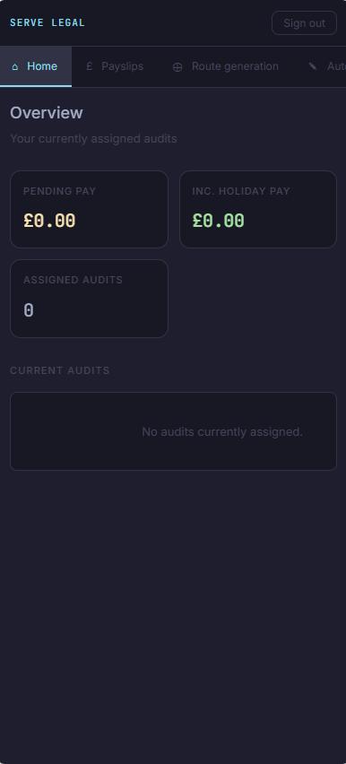
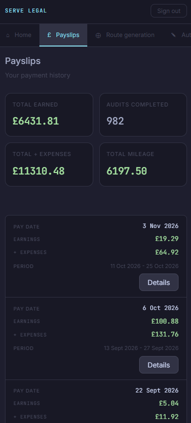
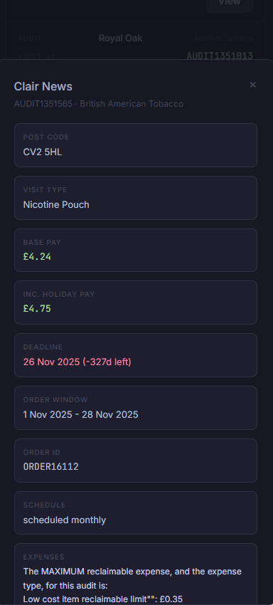
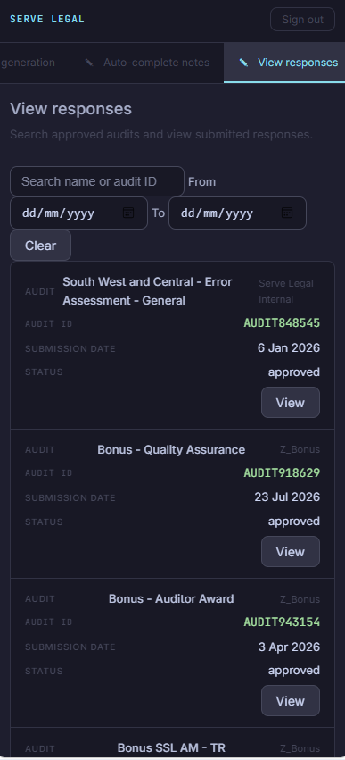

# AuditDashboard Route Optimizer & C++ Web Server

A high-performance, lightweight C++ backend service that solves multi-stop routing problems using an exact **Held-Karp Dynamic Programming** algorithm, integrated with **OpenRouteService**.

---

## Key Features

* **Exact TSP Solver (Held-Karp):** Unlike greedy heuristics (like Nearest Neighbor) that compromise on route quality, this implementation guarantees mathematical optimality using bitmasking dynamic programming ($O(n^2 2^n)$ time complexity).
* **Modern C++ Core:** Written in standard C++ with zero heavy external dependencies outside of standard utilities and `nlohmann/json`.
* **Containerized Deployment:** Fully dockerized for seamless builds and environment consistency.

---

## Showcase






## Architecture Overview

```text
Incoming API Request -> ApiClient -> DistanceMatrix (JSON Parsing) -> HeldKarp::solve() -> Optimal Route / Google Maps Link
```
## Try it yourself
Use for free right now on [Here](https://auditdashboard-utb7.onrender.com/)

This project is dockerized

# Build the Docker image
docker build -t audit-dashboard-server .

# Run the container
docker run -p 8080:8080 audit-dashboard-server
<<<<<<< HEAD


# Run with cmake
```
pip install pycognito
mkdir build
cd build
cmake .. ; cmake --build ./ ; ./Debug/WebServer.exe
```
## Ideas
Select which audits to route - done
text document storing the order in which to complete them. - done
fix showAuditDetailFromResponse function in dashboard.js

